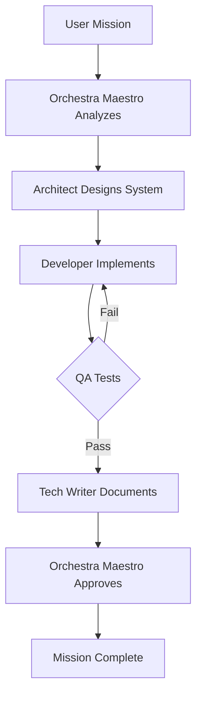

# 🎭 Kibi Orchestra - AI Workforce Management System

<div align="center">

**A revolutionary 3D virtual office where AI agents work together as an orchestrated team**

[](https://www.typescriptlang.org/)
[](https://reactjs.org/)
[](https://threejs.org/)
[](https://vitejs.dev/)
[](https://www.python.org/)
[](https://fastapi.tiangolo.com/)

</div>

---

## 🌟 Overview

Kibi Orchestra is not just another AI chatbot - it's a **complete AI workforce coordination system** that simulates a real software development office in stunning 3D. Watch as AI agents with different roles, authorities, and capabilities collaborate to complete complex tasks, just like a real development team.

### 🎯 Core Concept

**Traditional AI Agents**: Single AI model answering questions  
**Kibi Orchestra**: A full virtual office where specialized AI agents work together with hierarchy, authority levels, and escalation protocols

Think of it as a **virtual software company** where:
- 🎩 **Orchestra Maestro** - Makes strategic decisions (Authority: 10)
- 🏗️ **Architects** - Design system architecture (Authority: 8)
- 💻 **Developers** - Write code (Authority: 4-6)
- 🔍 **QA Engineers** - Test and validate (Authority: 3)
- 📝 **Technical Writers** - Document everything (Authority: 2)
- 🎓 **Interns** - Learn and assist (Authority: 1)

---

## ✨ Key Features

### 🏢 Immersive 3D Virtual Office
- **Real-time 3D rendering** with Three.js
- Beautiful office environment with dedicated work zones
- Live animated characters representing each AI agent
- Smooth camera controls with 360° rotation
- Performance-optimized rendering (60 FPS)

### 🤖 Intelligent Agent System
- **Authority-based hierarchy** (0-10 levels)
- **Dynamic model selection** - Uses budget models for simple tasks, premium models for complex ones
- **Escalation protocols** - Lower authority agents can escalate to higher authority
- **Context-aware execution** - Each agent receives only relevant information
- **Review loops** - Multi-layer quality control (Plan → Execute → Test → Review)

### 🎛️ Real-time Orchestration
- Live task board with Kanban-style workflow
- Event stream showing agent activities
- Agent status monitoring (Idle, Planning, Coding, Testing, Reviewing)
- Mission progress tracking
- Cost optimization through smart model routing

### 🔄 Backend Integration
- **FastAPI** backend for AI orchestration
- **9Router** integration for multi-provider AI access
- **Obsidian** vault integration for knowledge management
- Automated documentation generation
- SOP (Standard Operating Procedures) management

---

## 🛠️ Tech Stack

### Frontend
- **React 19** - Modern UI framework
- **TypeScript** - Type-safe development
- **Three.js** - 3D graphics and rendering
- **Tailwind CSS 4** - Modern styling system
- **Zustand** - State management
- **Vite** - Lightning-fast build tool
- **Motion** - Smooth animations
- **Lucide React** - Beautiful icons

### Backend
- **Python 3.14** - Backend runtime
- **FastAPI** - High-performance API framework
- **9Router** - Multi-provider AI gateway
- **Requests** - HTTP client
- **python-dotenv** - Environment management

### 3D & Graphics
- **Three.js 0.186** - WebGL rendering
- **OrbitControls** - Camera manipulation
- **Custom shaders** - Optimized materials
- **Shadow mapping** - Realistic lighting

---

## 🚀 Quick Start

### Prerequisites
- **Node.js** 18+ and npm/bun
- **Python** 3.9+ (for backend)
- Modern browser with WebGL support

### Installation

1. **Clone the repository**
```bash
git clone https://github.com/Inineo/Kibi-Orchestra-AI-Office.git
cd Kibi-Orchestra-AI-Office
```

2. **Install frontend dependencies**
```bash
npm install
# or
bun install
```

3. **Install backend dependencies**
```bash
cd backend
pip install -r requirements.txt
cd ..
```

4. **Configure environment variables**
```bash
cp .env.example .env
```

Edit `.env` and add your API keys:
```env
# 9Router Configuration
VITE_9ROUTER_URL=http://localhost:20128
VITE_9ROUTER_API_KEY=your_api_key_here

# Default AI Model
DEFAULT_AI_MODEL=openai/gpt-4o-mini

# Obsidian Integration (optional)
OBSIDIAN_ANTIGRAVITY_PATH=D:\Obsidian\Obsidian Memories\antigravity
CURRENT_PROJECT_NAME=Kibi-Orchestra
```

5. **Start the development server**

**Frontend:**
```bash
npm run dev
```
Open http://localhost:3000

**Backend (optional):**
```bash
cd backend
python main.py
```
Backend runs on http://localhost:8000

---

## 📖 Usage

### Creating a Mission

1. Click the **"New Mission"** button in the command center
2. Enter your mission description (e.g., "Add authentication with JWT")
3. Watch as the Orchestra Maestro analyzes and delegates tasks
4. Monitor real-time progress in the 3D office

### Interacting with Agents

- **Click on an agent** to view their current task and status
- **Hover over desks** to see agent roles and activity
- **Use the task board** to track workflow progress
- **Check the event stream** for detailed activity logs

### Camera Controls

- **Left Click + Drag**: Rotate camera
- **Right Click + Drag**: Pan camera
- **Mouse Wheel**: Zoom in/out
- **Double Click Agent**: Focus camera on agent

---

## 🏗️ Project Structure

```
Kibi-Orchestra-V3/
├── src/
│   ├── components/
│   │   ├── office3d/           # 3D office scene components
│   │   │   ├── ThreeOfficeScene.ts  # Main 3D engine (1900+ lines)
│   │   │   └── OfficeCanvas.tsx     # React wrapper
│   │   ├── panels/             # UI panels (TaskBoard, Stats, Events)
│   │   ├── modals/             # Modal dialogs
│   │   ├── simple/             # Simple UI components
│   │   └── ui/                 # Reusable UI components
│   ├── stores/
│   │   └── useOfficeStore.ts   # Zustand state management
│   ├── types/
│   │   └── office.ts           # TypeScript type definitions
│   ├── data/
│   │   └── initialData.ts      # Default agent configurations
│   └── lib/
│       ├── utils.ts            # Utility functions
│       └── aiClient.ts         # AI client integration
├── backend/
│   ├── main.py                 # FastAPI server
│   ├── config.py               # Configuration management
│   ├── services/
│   │   ├── orchestrator.py     # AI workflow orchestration
│   │   ├── obsidian.py         # Obsidian integration
│   │   ├── caveman.py          # Token compression
│   │   └── intern_safety.py    # Safety protocols
│   └── *.py                    # Utility scripts
├── ai-workforce-orchestra-docs/  # Comprehensive documentation
│   ├── 01-PROJECT-OVERVIEW.md
│   ├── 02-ARCHITECTURE.md
│   ├── 03-TECH-STACK.md
│   └── ...
└── package.json
```

---

## 🎨 3D Office Design

The virtual office features three distinct zones:

### 🎭 Orchestra Pod (Center)
- **1 Maestro** - Strategic command center
- Panoramic curved monitor for system-wide overview
- Premium ergonomic setup

### 💻 Engineering Bay (Left Wing)
- **Frontend & Backend Developers**
- Dual-monitor workstations
- Collaborative development zone

### 📋 Quality & Docs Studio (Right Wing)
- **QA Engineer & Tech Writer**
- Testing and documentation workspace
- Quality assurance hub

---

## 🧠 Agent Roles & Authority

| Role | Authority | Model Policy | Responsibilities |
|------|-----------|--------------|------------------|
| **Orchestra Maestro** | 10 | Premium (Claude-3.5) | Strategic decisions, final approval |
| **System Architect** | 8 | Premium (Claude-3.5) | Architecture design, locked decisions |
| **Senior Developer** | 6 | Dynamic | Complex implementations |
| **Developer** | 4 | Budget (DeepSeek) | Standard coding tasks |
| **QA Engineer** | 3 | Standard (GPT-4) | Testing & validation |
| **Technical Writer** | 2 | Budget (Gemini-Flash) | Documentation |
| **Intern** | 1 | Budget | Learning & assistance |

**Key Principle**: Lower authority cannot override higher authority decisions - they must escalate!

---

## 🎯 Workflow Example



---

## 🔧 Backend API Endpoints

### Mission Management
- `POST /api/mission/start` - Start a new mission
- `GET /api/mission/{id}/status` - Check mission status
- `POST /api/mission/{id}/abort` - Abort mission

### Agent Operations
- `POST /api/agent/{role}/assign` - Assign task to agent
- `GET /api/agent/{role}/status` - Get agent status
- `POST /api/agent/{role}/escalate` - Escalate to higher authority

### Obsidian Integration
- `POST /api/obsidian/sync-docs` - Sync documentation to vault
- `POST /api/obsidian/create-index` - Generate index notes
- `POST /api/obsidian/create-sop` - Create SOPs

---

## 📊 Performance Optimizations

### 3D Rendering
- ✅ Shadow map resolution reduced to 1024 (4x lighter on VRAM)
- ✅ Pixel ratio capped at 1.25 on high-DPI screens
- ✅ Raycasting throttled to ~30fps (32ms)
- ✅ Skip rendering when browser tab hidden
- ✅ Medium precision shaders for 40% fillrate savings
- ✅ Basic shadow map (faster than PCF soft shadows)

### State Management
- ✅ Zustand for lightweight state
- ✅ Context selectivity - agents receive only relevant data
- ✅ Event-driven architecture

---

## 🔮 Roadmap

### Phase 1: MVP (Current)
- [x] 3D office visualization
- [x] Basic agent system
- [x] Task board UI
- [x] Backend orchestration
- [x] 9Router integration

### Phase 2: Intelligence
- [ ] Memory system for agents
- [ ] Parallel task execution
- [ ] Advanced context optimization
- [ ] Cost prediction engine
- [ ] Custom workflow templates

### Phase 3: Scale
- [ ] Multi-mission support
- [ ] Team collaboration features
- [ ] A/B testing workflows
- [ ] Production deployment
- [ ] Cloud hosting

---

## 🤝 Contributing

Contributions are welcome! Please read our contributing guidelines:

1. Fork the repository
2. Create a feature branch (`git checkout -b feature/amazing-feature`)
3. Commit your changes (`git commit -m 'Add amazing feature'`)
4. Push to the branch (`git push origin feature/amazing-feature`)
5. Open a Pull Request

---

## 📄 License

This project is licensed under the MIT License - see the [LICENSE](LICENSE) file for details.

---

## 🙏 Acknowledgments

- **9Router** - Multi-provider AI gateway
- **Antigravity** - AI-powered IDE
- **Three.js** - Amazing 3D library
- **React** & **Vite** - Modern web development
- **FastAPI** - High-performance Python API framework

---

## 📞 Contact

**Project Maintainer**: Inineo  
**Repository**: [github.com/Inineo/Kibi-Orchestra-AI-Office](https://github.com/Inineo/Kibi-Orchestra-AI-Office)

---

<div align="center">

**Made with ❤️ by the AI Orchestra Team**

⭐ Star this repo if you find it useful!

</div>
