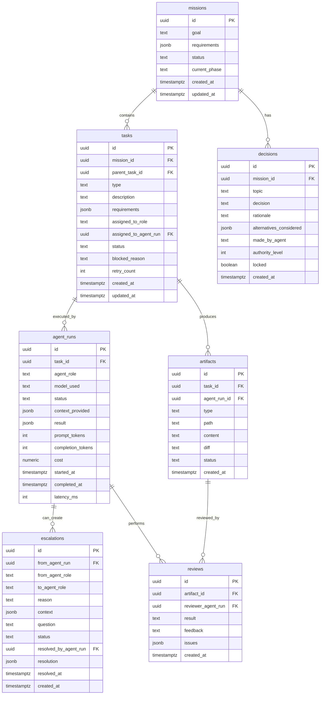

# Database Schema - AI Workforce Orchestra

**Last Updated**: 2026-10-05  
**Status**: Schema Complete - Ready for Implementation

---

## 🗄️ Database Technology

**Database**: PostgreSQL 15+  
**Hosting**: Supabase (managed PostgreSQL)  
**ORM**: Prisma 5.x  
**Extensions**: pgvector (for Phase 2 - memory/embeddings)

---

## 📊 Schema Overview



---

## 📝 Table Definitions

### 1. missions

High-level user goals that drive the entire workflow.

```sql
CREATE TABLE missions (
  id UUID PRIMARY KEY DEFAULT gen_random_uuid(),
  goal TEXT NOT NULL,
  requirements JSONB DEFAULT '[]',
  status TEXT NOT NULL CHECK (status IN (
    'planning',
    'in_progress',
    'review',
    'completed',
    'failed',
    'cancelled'
  )),
  current_phase TEXT,
  created_at TIMESTAMPTZ NOT NULL DEFAULT NOW(),
  updated_at TIMESTAMPTZ NOT NULL DEFAULT NOW()
);

CREATE INDEX idx_missions_status ON missions(status);
CREATE INDEX idx_missions_created_at ON missions(created_at DESC);
```

**Example**:
```json
{
  "id": "550e8400-e29b-41d4-a716-446655440000",
  "goal": "Add JWT authentication system",
  "requirements": [
    "Use JWT with refresh tokens",
    "Store sessions in database",
    "Add login/logout endpoints",
    "Implement auth middleware"
  ],
  "status": "in_progress",
  "current_phase": "implementation",
  "created_at": "2026-10-05T03:00:00Z",
  "updated_at": "2026-10-05T03:15:00Z"
}
```

---

### 2. decisions

Locked architectural and strategic decisions made by high-authority agents.

```sql
CREATE TABLE decisions (
  id UUID PRIMARY KEY DEFAULT gen_random_uuid(),
  mission_id UUID NOT NULL REFERENCES missions(id) ON DELETE CASCADE,
  topic TEXT NOT NULL,
  decision TEXT NOT NULL,
  rationale TEXT,
  alternatives_considered JSONB DEFAULT '[]',
  made_by_agent TEXT NOT NULL,
  authority_level INTEGER NOT NULL CHECK (authority_level BETWEEN 1 AND 10),
  locked BOOLEAN DEFAULT false,
  created_at TIMESTAMPTZ NOT NULL DEFAULT NOW()
);

CREATE INDEX idx_decisions_mission_id ON decisions(mission_id);
CREATE INDEX idx_decisions_locked ON decisions(locked) WHERE locked = true;
CREATE INDEX idx_decisions_topic ON decisions(topic);
```

**Example**:
```json
{
  "id": "dec-001",
  "mission_id": "550e8400-e29b-41d4-a716-446655440000",
  "topic": "authentication_method",
  "decision": "Use JWT with refresh tokens stored in database",
  "rationale": "ACID transactions needed for session management, refresh token rotation provides better security than long-lived tokens",
  "alternatives_considered": [
    "Session-based auth (doesn't scale with microservices)",
    "JWT only without refresh (security risk)",
    "OAuth2 only (too complex for MVP)"
  ],
  "made_by_agent": "architect",
  "authority_level": 8,
  "locked": true,
  "created_at": "2026-10-05T03:05:00Z"
}
```

**Key Principle**: Lower authority agents CANNOT override locked decisions.

---

### 3. tasks

Units of work that make up a mission.

```sql
CREATE TABLE tasks (
  id UUID PRIMARY KEY DEFAULT gen_random_uuid(),
  mission_id UUID REFERENCES missions(id) ON DELETE CASCADE,
  parent_task_id UUID REFERENCES tasks(id) ON DELETE CASCADE,
  
  type TEXT NOT NULL,
  description TEXT NOT NULL,
  requirements JSONB DEFAULT '[]',
  acceptance_criteria JSONB DEFAULT '[]',
  
  assigned_to_role TEXT,
  assigned_to_agent_run UUID,
  
  status TEXT NOT NULL CHECK (status IN (
    'pending',
    'assigned',
    'running',
    'blocked',
    'review',
    'rework',
    'approved',
    'completed',
    'failed'
  )),
  
  blocked_reason TEXT,
  blocked_by_task UUID REFERENCES tasks(id),
  retry_count INTEGER DEFAULT 0,
  
  depends_on JSONB DEFAULT '[]',
  
  created_at TIMESTAMPTZ NOT NULL DEFAULT NOW(),
  updated_at TIMESTAMPTZ NOT NULL DEFAULT NOW()
);

CREATE INDEX idx_tasks_mission_id ON tasks(mission_id);
CREATE INDEX idx_tasks_status ON tasks(status);
CREATE INDEX idx_tasks_assigned_role ON tasks(assigned_to_role);
CREATE INDEX idx_tasks_active ON tasks(status) 
  WHERE status IN ('pending', 'running', 'blocked');
```

**Task Types**:
- `analyze` - Requirements analysis
- `design` - Architecture/design
- `plan` - Task breakdown
- `implement` - Code implementation
- `test` - Testing
- `review` - Code review
- `refactor` - Code refactoring
- `document` - Documentation

**Example**:
```json
{
  "id": "task-001",
  "mission_id": "550e8400-e29b-41d4-a716-446655440000",
  "parent_task_id": null,
  "type": "implement",
  "description": "Create User model and migration",
  "requirements": [
    "User table with id, email, password_hash",
    "Sessions table with user_id, token, expires_at",
    "Use UUID for IDs",
    "Add proper indexes"
  ],
  "acceptance_criteria": [
    "Migration runs successfully",
    "Models have proper TypeScript types",
    "Foreign key constraints in place"
  ],
  "assigned_to_role": "developer",
  "assigned_to_agent_run": "run-001",
  "status": "running",
  "retry_count": 0,
  "depends_on": [],
  "created_at": "2026-10-05T03:10:00Z",
  "updated_at": "2026-10-05T03:10:05Z"
}
```

---

### 4. agent_runs

Records of agent executions (one agent run = one API call to model).

```sql
CREATE TABLE agent_runs (
  id UUID PRIMARY KEY DEFAULT gen_random_uuid(),
  task_id UUID NOT NULL REFERENCES tasks(id) ON DELETE CASCADE,
  agent_role TEXT NOT NULL,
  model_used TEXT NOT NULL,
  
  status TEXT NOT NULL CHECK (status IN (
    'running',
    'completed',
    'failed',
    'escalated'
  )),
  
  context_provided JSONB,
  result JSONB,
  structured_output JSONB,
  
  prompt_tokens INTEGER DEFAULT 0,
  completion_tokens INTEGER DEFAULT 0,
  cost NUMERIC(10,6) DEFAULT 0,
  
  started_at TIMESTAMPTZ NOT NULL DEFAULT NOW(),
  completed_at TIMESTAMPTZ,
  latency_ms INTEGER
);

CREATE INDEX idx_agent_runs_task_id ON agent_runs(task_id);
CREATE INDEX idx_agent_runs_started_at ON agent_runs(started_at DESC);
CREATE INDEX idx_agent_runs_agent_role ON agent_runs(agent_role);
CREATE INDEX idx_agent_runs_model ON agent_runs(model_used);
```

**Example**:
```json
{
  "id": "run-001",
  "task_id": "task-001",
  "agent_role": "developer",
  "model_used": "opencode/deepseek-coder",
  "status": "completed",
  "context_provided": {
    "task": { "description": "Create User model..." },
    "architecture_decisions": [...],
    "coding_conventions": [...]
  },
  "result": {
    "artifacts": ["models/User.ts", "migrations/001_create_users.sql"]
  },
  "prompt_tokens": 5420,
  "completion_tokens": 1250,
  "cost": 0.000896,
  "started_at": "2026-10-05T03:10:05Z",
  "completed_at": "2026-10-05T03:10:42Z",
  "latency_ms": 37000
}
```

---

### 5. escalations

Requests from lower-authority agents to higher-authority agents.

```sql
CREATE TABLE escalations (
  id UUID PRIMARY KEY DEFAULT gen_random_uuid(),
  from_agent_run UUID NOT NULL REFERENCES agent_runs(id) ON DELETE CASCADE,
  from_agent_role TEXT NOT NULL,
  to_agent_role TEXT NOT NULL,
  
  reason TEXT NOT NULL,
  context JSONB,
  question TEXT,
  
  status TEXT NOT NULL CHECK (status IN (
    'pending',
    'answered',
    'rejected'
  )),
  
  resolved_by_agent_run UUID REFERENCES agent_runs(id),
  resolution JSONB,
  resolved_at TIMESTAMPTZ,
  
  created_at TIMESTAMPTZ NOT NULL DEFAULT NOW()
);

CREATE INDEX idx_escalations_status ON escalations(status) 
  WHERE status = 'pending';
CREATE INDEX idx_escalations_from_run ON escalations(from_agent_run);
CREATE INDEX idx_escalations_created_at ON escalations(created_at DESC);
```

**Example**:
```json
{
  "id": "esc-001",
  "from_agent_run": "run-001",
  "from_agent_role": "developer",
  "to_agent_role": "architect",
  "reason": "Database schema change required",
  "context": {
    "attempted_change": "Add password_reset_token to users table",
    "blocked_by_decision": "dec-001"
  },
  "question": "Should we add password reset functionality to the User model now, or defer to Phase 2?",
  "status": "answered",
  "resolved_by_agent_run": "run-002",
  "resolution": {
    "decision": "APPROVED",
    "rationale": "Password reset is part of auth system scope",
    "modifications": {
      "add_columns": ["password_reset_token", "reset_token_expires_at"]
    },
    "lock_decision": true
  },
  "resolved_at": "2026-10-05T03:12:00Z",
  "created_at": "2026-10-05T03:11:00Z"
}
```

---

### 6. artifacts

Code files, documents, and other outputs produced by agents.

```sql
CREATE TABLE artifacts (
  id UUID PRIMARY KEY DEFAULT gen_random_uuid(),
  task_id UUID NOT NULL REFERENCES tasks(id) ON DELETE CASCADE,
  agent_run_id UUID NOT NULL REFERENCES agent_runs(id) ON DELETE CASCADE,
  
  type TEXT NOT NULL CHECK (type IN (
    'code',
    'test',
    'document',
    'config',
    'diagram',
    'migration'
  )),
  
  path TEXT NOT NULL,
  content TEXT,
  content_url TEXT,
  diff TEXT,
  
  status TEXT NOT NULL CHECK (status IN (
    'draft',
    'submitted',
    'approved',
    'applied',
    'rejected'
  )),
  
  created_at TIMESTAMPTZ NOT NULL DEFAULT NOW()
);

CREATE INDEX idx_artifacts_task_id ON artifacts(task_id);
CREATE INDEX idx_artifacts_agent_run ON artifacts(agent_run_id);
CREATE INDEX idx_artifacts_status ON artifacts(status);
CREATE INDEX idx_artifacts_type ON artifacts(type);
```

**Storage Strategy**:
- Small files (<1MB): Store in `content` column
- Large files (>1MB): Store in filesystem, reference via `content_url`

**Example**:
```json
{
  "id": "art-001",
  "task_id": "task-001",
  "agent_run_id": "run-001",
  "type": "code",
  "path": "src/models/User.ts",
  "content": "import { Prisma } from '@prisma/client';\n\nexport interface User {...}",
  "diff": "@@ -0,0 +1,25 @@\n+import { Prisma }...",
  "status": "submitted",
  "created_at": "2026-10-05T03:10:42Z"
}
```

---

### 7. reviews

Quality control checks on artifacts.

```sql
CREATE TABLE reviews (
  id UUID PRIMARY KEY DEFAULT gen_random_uuid(),
  artifact_id UUID NOT NULL REFERENCES artifacts(id) ON DELETE CASCADE,
  reviewer_agent_run UUID NOT NULL REFERENCES agent_runs(id) ON DELETE CASCADE,
  
  result TEXT NOT NULL CHECK (result IN (
    'pass',
    'fail',
    'rework',
    'escalate'
  )),
  
  feedback TEXT,
  issues JSONB DEFAULT '[]',
  
  created_at TIMESTAMPTZ NOT NULL DEFAULT NOW()
);

CREATE INDEX idx_reviews_artifact_id ON reviews(artifact_id);
CREATE INDEX idx_reviews_result ON reviews(result);
```

**Issues Structure**:
```typescript
interface Issue {
  severity: 'critical' | 'major' | 'minor' | 'suggestion';
  type: 'correctness' | 'security' | 'performance' | 'style' | 'architecture';
  description: string;
  location: string;
  suggested_fix?: string;
}
```

**Example**:
```json
{
  "id": "rev-001",
  "artifact_id": "art-001",
  "reviewer_agent_run": "run-003",
  "result": "rework",
  "feedback": "Code structure is good, but missing edge case handling for duplicate emails",
  "issues": [
    {
      "severity": "major",
      "type": "correctness",
      "description": "No unique constraint check before inserting user",
      "location": "User.create() method",
      "suggested_fix": "Add try-catch for Prisma unique constraint violation"
    }
  ],
  "created_at": "2026-10-05T03:11:30Z"
}
```

---

### 8. events

Real-time state change notifications for UI updates.

```sql
CREATE TABLE events (
  id UUID PRIMARY KEY DEFAULT gen_random_uuid(),
  type TEXT NOT NULL,
  payload JSONB NOT NULL,
  timestamp TIMESTAMPTZ NOT NULL DEFAULT NOW()
);

CREATE INDEX idx_events_timestamp ON events(timestamp DESC);
CREATE INDEX idx_events_type ON events(type);

-- Automatic cleanup of old events (keep last 7 days)
CREATE INDEX idx_events_cleanup ON events(timestamp) 
  WHERE timestamp < NOW() - INTERVAL '7 days';
```

**Event Types**:
- `mission.created`
- `mission.updated`
- `task.created`
- `task.assigned`
- `task.status_changed`
- `agent.started`
- `agent.completed`
- `escalation.created`
- `escalation.resolved`
- `artifact.created`
- `review.completed`

**Example**:
```json
{
  "id": "evt-001",
  "type": "task.status_changed",
  "payload": {
    "task_id": "task-001",
    "old_status": "assigned",
    "new_status": "running",
    "agent_role": "developer",
    "agent_run_id": "run-001"
  },
  "timestamp": "2026-10-05T03:10:05Z"
}
```

---

### 9. memory (Phase 2 - Future)

Long-term knowledge and patterns learned from past missions.

```sql
CREATE EXTENSION IF NOT EXISTS vector;

CREATE TABLE memory (
  id UUID PRIMARY KEY DEFAULT gen_random_uuid(),
  type TEXT NOT NULL CHECK (type IN (
    'lesson',
    'pattern',
    'failure',
    'success',
    'best_practice'
  )),
  
  content TEXT NOT NULL,
  context JSONB,
  tags TEXT[] DEFAULT '{}',
  
  embedding VECTOR(1536),
  
  relevance_score FLOAT DEFAULT 1.0,
  created_at TIMESTAMPTZ NOT NULL DEFAULT NOW(),
  last_accessed TIMESTAMPTZ,
  access_count INTEGER DEFAULT 0
);

CREATE INDEX idx_memory_type ON memory(type);
CREATE INDEX idx_memory_tags ON memory USING GIN(tags);
CREATE INDEX idx_memory_embedding ON memory 
  USING ivfflat (embedding vector_cosine_ops);
CREATE INDEX idx_memory_relevance ON memory(relevance_score DESC);
```

**Not implemented in MVP** - Added in Phase 2 for learning capabilities.

---

## 🔄 State Transitions

### Task Status Flow

```
PENDING → ASSIGNED → RUNNING → REVIEW → APPROVED → COMPLETED
                         ↓         ↓
                      BLOCKED   REWORK
                         ↓         ↓
                      UNBLOCKED  (back to RUNNING)
                         ↓
                      RUNNING
```

### Artifact Status Flow

```
DRAFT → SUBMITTED → APPROVED → APPLIED
           ↓
        REJECTED
```

---

## 🔐 Prisma Schema

```prisma
// prisma/schema.prisma

generator client {
  provider = "prisma-client-js"
}

datasource db {
  provider = "postgresql"
  url      = env("DATABASE_URL")
}

model Mission {
  id           String    @id @default(uuid())
  goal         String
  requirements Json      @default("[]")
  status       String    // enum in application code
  currentPhase String?   @map("current_phase")
  createdAt    DateTime  @default(now()) @map("created_at")
  updatedAt    DateTime  @updatedAt @map("updated_at")
  
  tasks        Task[]
  decisions    Decision[]
  
  @@index([status])
  @@index([createdAt(sort: Desc)])
  @@map("missions")
}

model Decision {
  id                      String   @id @default(uuid())
  missionId               String   @map("mission_id")
  topic                   String
  decision                String
  rationale               String?
  alternativesConsidered  Json     @default("[]") @map("alternatives_considered")
  madeByAgent             String   @map("made_by_agent")
  authorityLevel          Int      @map("authority_level")
  locked                  Boolean  @default(false)
  createdAt               DateTime @default(now()) @map("created_at")
  
  mission                 Mission  @relation(fields: [missionId], references: [id], onDelete: Cascade)
  
  @@index([missionId])
  @@index([locked])
  @@index([topic])
  @@map("decisions")
}

model Task {
  id                  String    @id @default(uuid())
  missionId           String?   @map("mission_id")
  parentTaskId        String?   @map("parent_task_id")
  type                String
  description         String
  requirements        Json      @default("[]")
  acceptanceCriteria  Json      @default("[]") @map("acceptance_criteria")
  assignedToRole      String?   @map("assigned_to_role")
  assignedToAgentRun  String?   @map("assigned_to_agent_run")
  status              String
  blockedReason       String?   @map("blocked_reason")
  blockedByTask       String?   @map("blocked_by_task")
  retryCount          Int       @default(0) @map("retry_count")
  dependsOn           Json      @default("[]") @map("depends_on")
  createdAt           DateTime  @default(now()) @map("created_at")
  updatedAt           DateTime  @updatedAt @map("updated_at")
  
  mission             Mission?  @relation(fields: [missionId], references: [id], onDelete: Cascade)
  parentTask          Task?     @relation("TaskHierarchy", fields: [parentTaskId], references: [id], onDelete: Cascade)
  subtasks            Task[]    @relation("TaskHierarchy")
  agentRuns           AgentRun[]
  artifacts           Artifact[]
  
  @@index([missionId])
  @@index([status])
  @@index([assignedToRole])
  @@map("tasks")
}

model AgentRun {
  id               String    @id @default(uuid())
  taskId           String    @map("task_id")
  agentRole        String    @map("agent_role")
  modelUsed        String    @map("model_used")
  status           String
  contextProvided  Json?     @map("context_provided")
  result           Json?
  structuredOutput Json?     @map("structured_output")
  promptTokens     Int       @default(0) @map("prompt_tokens")
  completionTokens Int       @default(0) @map("completion_tokens")
  cost             Decimal   @default(0) @db.Decimal(10, 6)
  startedAt        DateTime  @default(now()) @map("started_at")
  completedAt      DateTime? @map("completed_at")
  latencyMs        Int?      @map("latency_ms")
  
  task             Task      @relation(fields: [taskId], references: [id], onDelete: Cascade)
  escalationsFrom  Escalation[] @relation("EscalationFrom")
  escalationsResolved Escalation[] @relation("EscalationResolved")
  artifacts        Artifact[]
  reviews          Review[]
  
  @@index([taskId])
  @@index([startedAt(sort: Desc)])
  @@index([agentRole])
  @@index([modelUsed])
  @@map("agent_runs")
}

model Escalation {
  id                  String    @id @default(uuid())
  fromAgentRun        String    @map("from_agent_run")
  fromAgentRole       String    @map("from_agent_role")
  toAgentRole         String    @map("to_agent_role")
  reason              String
  context             Json?
  question            String?
  status              String
  resolvedByAgentRun  String?   @map("resolved_by_agent_run")
  resolution          Json?
  resolvedAt          DateTime? @map("resolved_at")
  createdAt           DateTime  @default(now()) @map("created_at")
  
  fromRun             AgentRun  @relation("EscalationFrom", fields: [fromAgentRun], references: [id], onDelete: Cascade)
  resolvedByRun       AgentRun? @relation("EscalationResolved", fields: [resolvedByAgentRun], references: [id])
  
  @@index([status])
  @@index([createdAt(sort: Desc)])
  @@map("escalations")
}

model Artifact {
  id          String   @id @default(uuid())
  taskId      String   @map("task_id")
  agentRunId  String   @map("agent_run_id")
  type        String
  path        String
  content     String?  @db.Text
  contentUrl  String?  @map("content_url")
  diff        String?  @db.Text
  status      String
  createdAt   DateTime @default(now()) @map("created_at")
  
  task        Task     @relation(fields: [taskId], references: [id], onDelete: Cascade)
  agentRun    AgentRun @relation(fields: [agentRunId], references: [id], onDelete: Cascade)
  reviews     Review[]
  
  @@index([taskId])
  @@index([agentRunId])
  @@index([status])
  @@index([type])
  @@map("artifacts")
}

model Review {
  id                String   @id @default(uuid())
  artifactId        String   @map("artifact_id")
  reviewerAgentRun  String   @map("reviewer_agent_run")
  result            String
  feedback          String?  @db.Text
  issues            Json     @default("[]")
  createdAt         DateTime @default(now()) @map("created_at")
  
  artifact          Artifact @relation(fields: [artifactId], references: [id], onDelete: Cascade)
  reviewerRun       AgentRun @relation(fields: [reviewerAgentRun], references: [id], onDelete: Cascade)
  
  @@index([artifactId])
  @@index([result])
  @@map("reviews")
}

model Event {
  id        String   @id @default(uuid())
  type      String
  payload   Json
  timestamp DateTime @default(now())
  
  @@index([timestamp(sort: Desc)])
  @@index([type])
  @@map("events")
}
```

---

## 🔧 Migrations

### Initial Setup

```bash
# Initialize Prisma
npx prisma init

# Create migration
npx prisma migrate dev --name init

# Generate Prisma Client
npx prisma generate

# Seed database (optional)
npx prisma db seed
```

### Migration Strategy

1. **Development**: `prisma migrate dev` (creates migration + applies)
2. **Production**: `prisma migrate deploy` (applies existing migrations)
3. **Reset**: `prisma migrate reset` (WARNING: deletes all data)

---

## 📚 Related Documents

- **Architecture**: See `02-ARCHITECTURE.md`
- **Tech Stack**: See `03-TECH-STACK.md`
- **API Specification**: See `11-API-SPECIFICATION.md`

---

**Status**: Schema Complete - Ready for Prisma Implementation
