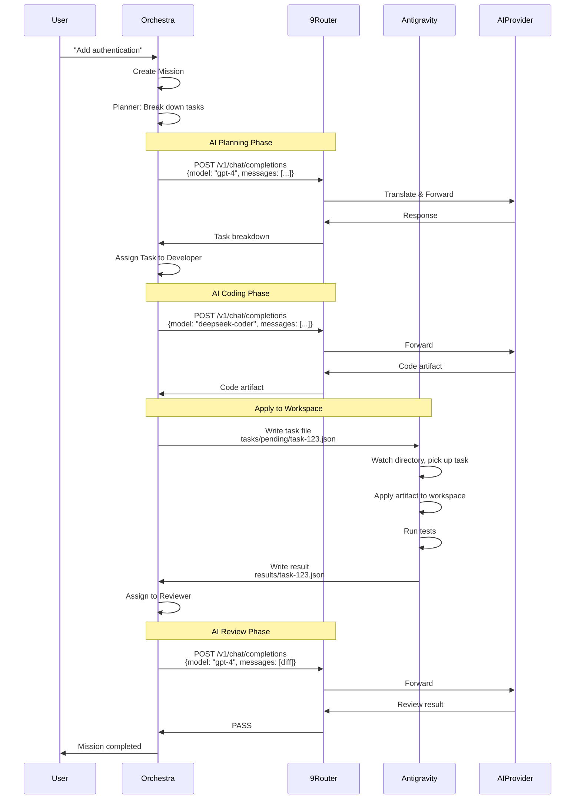

# 9Router & Antigravity Integration - AI Workforce Orchestra

**Last Updated**: 2026-10-05  
**Status**: Integration Strategy Defined

---

## 🎯 Integration Overview

Orchestra mengintegrasikan 2 sistem existing:

```
┌─────────────────────────────────────────────┐
│        ORCHESTRA (NEW)                      │
│     Coordination & State Management         │
└─────────┬───────────────────┬───────────────┘
          │                   │
          ↓                   ↓
    ┌──────────┐        ┌─────────────┐
    │ 9ROUTER  │        │ ANTIGRAVITY │
    │ (EXISTS) │        │  (EXISTS)   │
    └──────────┘        └─────────────┘
```

---

## 🔌 9Router Integration

### What is 9Router?

**Production-grade AI gateway** yang sudah ada dengan fitur:
- ✅ Multi-provider support (100+ AI providers)
- ✅ Credential management (multiple accounts per provider)
- ✅ Format translation (OpenAI ↔ Claude ↔ Gemini)
- ✅ Token optimization
- ✅ Rate limit handling
- ✅ Account fallback
- ✅ Usage tracking

### Integration Method: HTTP API

**Endpoint**: `http://localhost:20128/v1/chat/completions`

**Authentication**: API Key via Authorization header

```typescript
// Orchestra → 9Router integration
async function callAIModel(
  model: string,
  messages: Message[],
  options?: CallOptions
): Promise<AIResponse> {
  const response = await fetch('http://localhost:20128/v1/chat/completions', {
    method: 'POST',
    headers: {
      'Content-Type': 'application/json',
      'Authorization': `Bearer ${process.env.NINEROUTER_API_KEY}`
    },
    body: JSON.stringify({
      model: model,  // e.g., "anthropic/claude-3-5-sonnet"
      messages: messages,
      stream: false,  // Orchestra needs full response for validation
      tools: options?.tools,
      temperature: options?.temperature || 0.7,
      max_tokens: options?.maxTokens
    })
  });
  
  if (!response.ok) {
    throw new Error(`9Router error: ${response.status}`);
  }
  
  const data = await response.json();
  return parseAIResponse(data);
}
```

### Request Format

**OpenAI-compatible format** (9Router will translate to provider format):

```typescript
interface ChatCompletionRequest {
  model: string;           // "provider/model" or alias or combo
  messages: Message[];
  stream?: boolean;        // Default: false for Orchestra
  tools?: Tool[];          // Function calling
  tool_choice?: string;
  temperature?: number;
  max_tokens?: number;
  response_format?: {
    type: 'json_object' | 'json_schema';
    schema?: object;
  };
}

interface Message {
  role: 'system' | 'user' | 'assistant' | 'tool';
  content: string | ContentPart[];
  tool_calls?: ToolCall[];
  tool_call_id?: string;
}
```

### Response Format

```typescript
interface ChatCompletionResponse {
  id: string;
  object: 'chat.completion';
  created: number;
  model: string;
  choices: [{
    index: number;
    message: {
      role: 'assistant';
      content: string;
      tool_calls?: ToolCall[];
    };
    finish_reason: 'stop' | 'length' | 'tool_calls';
  }];
  usage: {
    prompt_tokens: number;
    completion_tokens: number;
    total_tokens: number;
  };
}
```

### Model Selection

Orchestra selects model, 9Router executes:

```typescript
// Model identifier formats supported by 9Router:
"anthropic/claude-3-5-sonnet-20241022"  // Provider/model
"gpt4"                                   // Alias (defined in 9Router)
"office-team"                            // Combo (fallback/round-robin/fusion)
"opencode/deepseek-coder"               // Budget coding model
```

### Error Handling

```typescript
try {
  const response = await callAIModel(model, messages);
  return response;
} catch (error) {
  if (error.status === 429) {
    // Rate limited - 9Router will handle fallback internally
    // Orchestra should retry or escalate
  } else if (error.status === 401) {
    // Invalid API key
    throw new ConfigurationError('9Router authentication failed');
  } else if (error.status === 503) {
    // All providers unavailable
    // Orchestra should escalate to human
  }
  throw error;
}
```

### Usage Tracking

9Router automatically tracks usage in its database:
- Token counts (prompt + completion)
- Cost calculation
- Latency
- Provider/model used

**Orchestra should**:
- Query 9Router's usage API (if available)
- OR track separately in Orchestra database
- Store in `agent_runs` table for analytics

### What Orchestra MUST Handle

❌ 9Router does NOT provide:
- Task orchestration
- State management
- Context selection (sends full request to model)
- Review loops
- Dynamic model selection based on task complexity
- Escalation logic
- Workflow coordination

✅ Orchestra responsibilities:
- Select which model to use
- Build appropriate context for each agent
- Manage conversation state across tasks
- Handle escalations
- Coordinate review cycles
- Enforce authority rules

---

## 🔧 Antigravity Integration

### What is Antigravity?

**Google Deepmind's Advanced Agentic Coding environment** with:
- ✅ File operations (read, write, edit)
- ✅ Command execution (build, test, lint)
- ✅ Git operations
- ✅ Codebase context
- ✅ Test runner

### Integration Challenge

**Unknown**: Antigravity's programmatic API (if exists)

**Found from context**: Antigravity has tools like:
- `run_command` - Execute shell commands
- `view_file` - Read files
- `replace_file_content` - Edit files
- `write_to_file` - Create files

**Problem**: How does Orchestra (external system) trigger these?

### Integration Strategy: File-based Communication (MVP)

**Concept**: Orchestra writes task files, Antigravity watches and executes.

```
┌──────────────────────────────────────────┐
│  SHARED FILESYSTEM                       │
│  ${sharedDir}/orchestra-workspace/       │
│                                          │
│  tasks/                                  │
│    pending/                              │
│      task-{uuid}.json    ← Orchestra     │
│    in_progress/                          │
│      task-{uuid}.json    ← Antigravity   │
│    completed/                            │
│      task-{uuid}.json    ← Antigravity   │
│                                          │
│  artifacts/                              │
│    {task-id}/                            │
│      src/models/User.ts  ← Antigravity   │
│      migrations/001.sql                  │
│                                          │
│  results/                                │
│    {task-id}.json        ← Antigravity   │
│                                          │
└──────────────────────────────────────────┘
```

### Workflow

#### 1. Orchestra writes task

```typescript
// Orchestra: Write task for Antigravity to execute
const task = {
  id: 'task-123',
  type: 'apply_artifact',
  artifact: {
    path: 'src/models/User.ts',
    content: '...',
    action: 'create'  // or 'update', 'delete'
  },
  commands: [
    'npm run type-check',
    'npm test src/models/User.test.ts'
  ],
  created_at: new Date().toISOString()
};

await fs.writeFile(
  `${SHARED_DIR}/tasks/pending/task-123.json`,
  JSON.stringify(task, null, 2)
);
```

#### 2. Antigravity watches and executes

```typescript
// Antigravity (or wrapper script) watches directory
const watcher = fs.watch(`${SHARED_DIR}/tasks/pending/`);

watcher.on('change', async (filename) => {
  const taskFile = path.join(SHARED_DIR, 'tasks/pending', filename);
  const task = JSON.parse(await fs.readFile(taskFile, 'utf8'));
  
  // Move to in_progress
  await fs.rename(
    taskFile,
    path.join(SHARED_DIR, 'tasks/in_progress', filename)
  );
  
  // Execute task
  try {
    if (task.type === 'apply_artifact') {
      // Write file to workspace
      await fs.writeFile(
        path.join(WORKSPACE, task.artifact.path),
        task.artifact.content
      );
    }
    
    // Run commands
    for (const cmd of task.commands) {
      const result = await exec(cmd);
      // Store output
    }
    
    // Write result
    await fs.writeFile(
      path.join(SHARED_DIR, 'results', `${task.id}.json`),
      JSON.stringify({
        task_id: task.id,
        status: 'success',
        outputs: [...],
        completed_at: new Date().toISOString()
      })
    );
    
    // Move to completed
    await fs.rename(
      path.join(SHARED_DIR, 'tasks/in_progress', filename),
      path.join(SHARED_DIR, 'tasks/completed', filename)
    );
    
  } catch (error) {
    // Write error result
    await fs.writeFile(
      path.join(SHARED_DIR, 'results', `${task.id}.json`),
      JSON.stringify({
        task_id: task.id,
        status: 'failed',
        error: error.message,
        completed_at: new Date().toISOString()
      })
    );
  }
});
```

#### 3. Orchestra polls for results

```typescript
// Orchestra: Poll for task completion
async function waitForTaskCompletion(taskId: string, timeoutMs = 300000) {
  const resultPath = path.join(SHARED_DIR, 'results', `${taskId}.json`);
  const startTime = Date.now();
  
  while (Date.now() - startTime < timeoutMs) {
    if (await fs.exists(resultPath)) {
      const result = JSON.parse(await fs.readFile(resultPath, 'utf8'));
      return result;
    }
    await sleep(1000);  // Poll every second
  }
  
  throw new Error(`Task ${taskId} timeout after ${timeoutMs}ms`);
}
```

### Task Types

```typescript
type AntigravityTask = 
  | ApplyArtifactTask
  | RunCommandTask
  | ReadFileTask
  | GetContextTask;

interface ApplyArtifactTask {
  id: string;
  type: 'apply_artifact';
  artifact: {
    path: string;
    content: string;
    action: 'create' | 'update' | 'delete';
  };
  commands?: string[];  // Post-apply validation
}

interface RunCommandTask {
  id: string;
  type: 'run_command';
  command: string;
  cwd?: string;
}

interface ReadFileTask {
  id: string;
  type: 'read_file';
  path: string;
}

interface GetContextTask {
  id: string;
  type: 'get_context';
  query: string;  // e.g., "Find all files importing User model"
}
```

### Alternative: HTTP API (If Available)

**If Antigravity exposes HTTP API** (needs investigation):

```typescript
// Hypothetical Antigravity API
await fetch('http://localhost:PORT/api/files', {
  method: 'POST',
  body: JSON.stringify({
    path: 'src/models/User.ts',
    content: '...',
    action: 'create'
  })
});

await fetch('http://localhost:PORT/api/commands', {
  method: 'POST',
  body: JSON.stringify({
    command: 'npm test',
    cwd: '/workspace'
  })
});
```

**This would be cleaner but requires Antigravity API documentation**

### Workspace Isolation

**Challenge**: Multiple agents working on same codebase

**Solutions**:

1. **Sequential Execution (MVP)**
   - Only one agent modifies files at a time
   - Simple, no conflicts
   - Slower

2. **Git Branches (Phase 2)**
   ```
   main
     ├─ feature/task-001 (Developer working)
     ├─ feature/task-002 (Developer working)
     └─ review/task-001 (Reviewer checking)
   ```

3. **Git Worktrees (Phase 2)**
   ```
   /workspace/main/       (pristine)
   /workspace/task-001/   (agent 1)
   /workspace/task-002/   (agent 2)
   ```

---

## 📊 Integration Architecture Diagram



---

## 🔧 Configuration

### Environment Variables

```bash
# 9Router Integration
NINEROUTER_URL="http://localhost:20128"
NINEROUTER_API_KEY="your-orchestra-api-key"

# Antigravity Integration (File-based)
ANTIGRAVITY_SHARED_DIR="/path/to/shared/workspace"
ANTIGRAVITY_POLL_INTERVAL_MS="1000"
ANTIGRAVITY_TASK_TIMEOUT_MS="300000"  # 5 minutes

# Or if HTTP API available:
# ANTIGRAVITY_URL="http://localhost:PORT"
# ANTIGRAVITY_API_KEY="..."
```

### Setup Steps

1. **Start 9Router**
   ```bash
   cd /path/to/9router
   npm run dev  # Runs on localhost:20128
   ```

2. **Configure Orchestra API Key in 9Router**
   - Open 9Router UI
   - Settings → API Keys
   - Create key named "Orchestra"
   - Copy key to Orchestra `.env`

3. **Setup Shared Directory**
   ```bash
   mkdir -p /path/to/shared/workspace/{tasks/{pending,in_progress,completed},artifacts,results}
   ```

4. **Start Antigravity Watcher** (if using file-based)
   ```bash
   node scripts/antigravity-watcher.js
   ```

---

## ⚠️ Integration Limitations & Workarounds

### 9Router Limitations

| Limitation | Impact | Workaround |
|------------|--------|------------|
| No task state | Can't query running tasks | Orchestra manages state |
| No context optimization | Sends full context | Orchestra pre-processes context |
| Fixed combo models | Can't dynamically change | Orchestra selects before calling |
| No structured decision tracking | Can't query past decisions | Orchestra stores in database |

### Antigravity Limitations

| Limitation | Impact | Workaround |
|------------|--------|------------|
| Unknown API | Can't integrate cleanly | File-based communication (MVP) |
| Concurrent access | File conflicts | Sequential execution (MVP) |
| No state query | Can't check current workspace | File-based polling |

---

## 📚 Related Documents

- **Architecture**: See `02-ARCHITECTURE.md`
- **Agent System**: See `05-AGENT-SYSTEM.md`
- **9Router Source Analysis**: See Architecture Audit files (conversation `091957d7-40b9-4ca7-a454-b823706f1000`)

---

**Status**: Integration Strategy Defined - File-based MVP, API-based future
