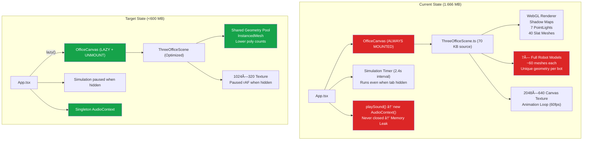

# 📋 16 — PERFORMANCE OPTIMIZATION PLAN

**Tanggal:** 12 Oktober 2026  
**Status:** ?? FASE 1+2 SELESAI  
**Status:** 🟢 FASE 1 SELESAI  
**Target Sistem:** RX 6600 (8GB VRAM) • 16 GB RAM • Chrome  
**Konteks:** Web harus jalan bersamaan dengan 9Router + Antigravity IDE

---

## 📊 Kondisi Saat Ini

| Metrik | Nilai | Target |
|--------|-------|--------|
| RAM Usage (Chrome) | ~1.666 MB | < 600 MB |
| GPU Usage | ~15% | < 5% (idle) |
| Bundle Size (JS) | 957 KB (1 chunk) | < 300 KB initial |
| Startup Parse Time | ~2-3s | < 1s |
| Tab Hidden GPU | 15% (tetap) | 0% |

---

## � Tujuan

1. Menurunkan RAM usage **dari ~1.6 GB menjadi < 600 MB** saat aktif di tab 3D
2. Menurunkan GPU usage **dari 15% menjadi < 5%** saat idle
3. **0% GPU dan minimal CPU** saat user pindah ke tab lain (Kanban, Activity, Settings)
4. Memungkinkan Kibi Orchestra **jalan simultan** dengan 9Router + Antigravity tanpa lag

---

## � Arsitektur Masalah



---

## 🔴 FASE 1 — P0 KRITIKAL (Estimasi: 20 menit, Hemat ~1.2 GB RAM + 12% GPU)

### OPT-01: Lazy Mount/Unmount 3D Scene Saat Pindah Tab

- **File:** `src/App.tsx`
- **Masalah:** `<OfficeCanvas />` selalu di-render meskipun user di tab Kanban/Activity/Settings. Three.js renderer, semua texture, geometry, dan rAF animation loop **tetap hidup di background** — membakar ~800 MB RAM dan ~12% GPU sia-sia.
- **Solusi:** Unmount komponen sepenuhnya saat tidak di tab `office3d`.
- **Implementasi:**

```diff
 // src/App.tsx
+import { lazy, Suspense } from 'react';
-import { OfficeCanvas } from './components/office3d/OfficeCanvas';
+const OfficeCanvas = lazy(() => import('./components/office3d/OfficeCanvas'));

 {currentTab === 'office3d' && (
-  <div className="w-full h-full relative">
-    <OfficeCanvas />
-  </div>
+  <Suspense fallback={<div className="w-full h-full flex items-center justify-center bg-black text-zinc-500 font-mono text-sm">Loading 3D Office...</div>}>
+    <div className="w-full h-full relative">
+      <OfficeCanvas />
+    </div>
+  </Suspense>
 )}
```

- **Estimasi Savings:** ~800 MB RAM + ~12% GPU saat tidak di tab 3D
- **Trade-off:** Kembali ke tab 3D butuh ~0.5–1s rebuild scene (mitigasi: loading indicator)
- **Status:** ? Selesai (12 Okt 2026)

---

### OPT-02: Code-Split Three.js via Dynamic Import

- **File:** `src/App.tsx`, `vite.config.ts`
- **Masalah:** Bundle JS = 957 KB single chunk. Three.js ~600 KB. Chrome parse seluruh file di main thread saat startup → ~300-500 MB memory untuk parsing & JIT compilation.
- **Solusi:** Pisahkan Three.js ke chunk tersendiri via Vite manual chunks + lazy import.
- **Implementasi:**

```diff
 // vite.config.ts — tambahkan di dalam defineConfig:
+build: {
+  rollupOptions: {
+    output: {
+      manualChunks: {
+        three: ['three'],
+        vendor: ['react', 'react-dom', 'zustand'],
+      }
+    }
+  }
+}
```

```diff
 // src/components/office3d/OfficeCanvas.tsx — tambahkan default export:
+export default OfficeCanvas;
```

- **Estimasi Savings:** ~400 MB startup RAM, initial load 2-3x lebih cepat
- **Status:** ✅ Selesai (12 Okt 2026)

---

### OPT-03: AudioContext Singleton (Fix Memory Leak)

- **File:** `src/stores/useOfficeStore.ts`
- **Masalah:** `playSound()` membuat **AudioContext baru setiap panggilan** dan tidak pernah `close()`. Setiap AudioContext = ~2-5 MB. Simulasi aktif bisa create 50+ context → 100-250 MB leaked.
- **Solusi:** Gunakan singleton AudioContext yang di-reuse.
- **Implementasi:**

```diff
 // src/stores/useOfficeStore.ts
+let sharedAudioCtx: AudioContext | null = null;
+
 export const playSound = (type: 'blip' | 'chime' | 'alert' | 'complete') => {
   try {
-    const ctx = new (window.AudioContext || (window as unknown as { webkitAudioContext: typeof AudioContext }).webkitAudioContext)();
-    if (ctx.state === 'suspended') {
-      ctx.resume();
-    }
+    if (!sharedAudioCtx) {
+      sharedAudioCtx = new (window.AudioContext || (window as unknown as { webkitAudioContext: typeof AudioContext }).webkitAudioContext)();
+    }
+    const ctx = sharedAudioCtx;
+    if (ctx.state === 'suspended') ctx.resume();
+
     const osc = ctx.createOscillator();
     // ... rest unchanged
```

- **Estimasi Savings:** ~50-100 MB (prevent leak)
- **Status:** � Selesai (12 Okt 2026)

---

## 🟠 FASE 2 — P1 BERAT (Estimasi: 45 menit, Hemat ~100-150 MB)

### OPT-04: Canvas Texture Downscale + Dispose

- **File:** `src/components/office3d/ThreeOfficeScene.ts` (line 423-530)
- **Masalah:** Wall Command Screen menggunakan canvas 2048×640 untuk konten statis. Mengkonsumsi ~5 MB VRAM + ~5 MB RAM untuk canvas element yang tidak pernah di-dispose.
- **Solusi:**
  1. Turunkan resolusi ke 1024×320 (masih tajam di viewing distance normal)
  2. Disable mipmap generation (statis, tidak perlu)
  3. Release canvas memory setelah texture upload ke GPU
- **Implementasi:**

```diff
 // ThreeOfficeScene.ts — createWallCommandScreen()
 const canvas = document.createElement('canvas');
-canvas.width = 2048;
-canvas.height = 640;
+canvas.width = 1024;
+canvas.height = 320;
 // ... drawing code (scale font sizes by 0.5x) ...

 const texture = new THREE.CanvasTexture(canvas);
 texture.minFilter = THREE.LinearFilter;
 texture.magFilter = THREE.LinearFilter;
+texture.generateMipmaps = false;
+
+// Release canvas memory after GPU upload
+canvas.width = 1;
+canvas.height = 1;
```

- **Estimasi Savings:** ~10 MB (RAM + VRAM)
- **Status:** ? Selesai (12 Okt 2026)

---

### OPT-05: Shared Geometry & Material Pool untuk Robot Bots

- **File:** `src/components/office3d/ThreeOfficeScene.ts` (line 1107-1553)
- **Masalah:** `createWorkstationAndWhiteChibiBot()` membuat geometry dan material unik per-agent. 7 agent × ~15 geometries × ~8 materials = **~105 geometries + ~56 materials** yang seharusnya bisa di-share.
- **Solusi:** Buat shared pools di constructor class, reuse di setiap bot creation.
- **Implementasi:**

```ts
// Tambahkan di class properties ThreeOfficeScene:
private sharedBotGeos = {
  head: new THREE.SphereGeometry(0.38, 16, 12),
  visor: new THREE.SphereGeometry(0.385, 16, 10, -Math.PI / 2.3, Math.PI * 0.86, Math.PI / 4, Math.PI / 2),
  eye: new THREE.CircleGeometry(0.065, 12, 0, Math.PI),
  blush: new THREE.CircleGeometry(0.042, 12),
  torso: new THREE.CylinderGeometry(0.20, 0.30, 0.44, 12),
  belly: new THREE.SphereGeometry(0.30, 12, 8, 0, Math.PI * 2, Math.PI / 2, Math.PI / 2),
  arm: new THREE.CylinderGeometry(0.055, 0.05, 0.28, 6),
  hand: new THREE.SphereGeometry(0.065, 8, 8),
  leg: new THREE.CylinderGeometry(0.06, 0.06, 0.20, 6),
  foot: new THREE.SphereGeometry(0.085, 10, 8),
  hitbox: new THREE.BoxGeometry(1.2, 1.8, 1.2),
};

private sharedBotMats = {
  body: new THREE.MeshStandardMaterial({ color: 0xffffff, roughness: 0.18, metalness: 0.06 }),
  visor: new THREE.MeshStandardMaterial({ color: 0x090a10, roughness: 0.08, metalness: 0.85 }),
  eye: new THREE.MeshBasicMaterial({ color: 0xffffff }),
  blush: new THREE.MeshBasicMaterial({ color: 0xf43f5e, transparent: true, opacity: 0.85 }),
  silver: new THREE.MeshStandardMaterial({ color: 0xc4c7cf, metalness: 0.8, roughness: 0.2 }),
};
```

- **Estimasi Savings:** ~30-50 MB (fewer GPU objects)
- **Status:** ? Selesai (12 Okt 2026)

---

### OPT-06: Reduce Polygon Count pada Geometri Dekoratif

- **File:** `src/components/office3d/ThreeOfficeScene.ts` (multiple locations)
- **Masalah:** Banyak objek kecil menggunakan segment count berlebihan:

| Object | Lokasi | Current Segments | Target | Triangle Savings |
|--------|--------|-----------------|--------|-----------------|
| Head sphere | L1286 | 24×20 (480 tri) | 16×12 (192 tri) | -60% |
| Visor sphere | L1293 | 24×16 | 16×10 | -58% |
| Clock torus rim | L557 | 12×24 (288 tri) | 8×16 (128 tri) | -55% |
| Beanbag sphere | L767 | 16×12 | 10×8 | -53% |
| Water jug cylinder | L863 | 16 segs | 10 segs | -37% |
| Ear cup cylinder | L1320 | 16 segs | 8 segs | -50% |
| Headphone ring torus | L1329 | 8×16 | 6×10 | -53% |

- **Estimasi Savings:** ~1000 triangles eliminated, ~10 MB GPU
- **Status:** ? Selesai (12 Okt 2026)

---

## 🟡 FASE 3 — P2 POLISH (Estimasi: 65 menit, Hemat CPU + prevent VRAM leak)

### OPT-07: Full Pause rAF Loop Saat Tab Hidden

- **File:** `src/components/office3d/ThreeOfficeScene.ts` (line 1744-1748)
- **Masalah:** Saat ini hanya `return` di awal animate ketika `document.hidden`, tapi `requestAnimationFrame` **tetap dipanggil** setiap frame. Browser masih schedule rAF callbacks (throttled, but not zero).
- **Solusi:** Cancel rAF sepenuhnya saat hidden, restart saat visible.
- **Implementasi:**

```ts
// Di constructor, tambahkan visibility listener:
this.handleVisibilityChange = this.handleVisibilityChange.bind(this);
document.addEventListener('visibilitychange', this.handleVisibilityChange);

// Method baru:
private handleVisibilityChange() {
  if (document.hidden) {
    if (this.animationFrameId !== null) {
      cancelAnimationFrame(this.animationFrameId);
      this.animationFrameId = null;
    }
  } else {
    this.clock.getDelta(); // Reset delta to avoid huge jump
    this.animate();
  }
}

// Di destroy(), tambahkan:
document.removeEventListener('visibilitychange', this.handleVisibilityChange);
```

- **Estimasi Savings:** CPU cycles saat tab hidden
- **Status:** ⬜ Belum Dikerjakan

---

### OPT-08: Wall Slats → InstancedMesh (40 Draw Calls → 1)

- **File:** `src/components/office3d/ThreeOfficeScene.ts` (line 389-401)
- **Masalah:** 40 individual BoxGeometry slats pada dinding = **40 draw calls** ke GPU.
- **Solusi:** Gunakan `InstancedMesh` untuk render semua slats dalam 1 draw call.
- **Implementasi:**

```ts
// Ganti loop createOfficeWalls() slat section:
const slatGeo = new THREE.BoxGeometry(0.18, 5.8, 0.05);
const leftSlats = Math.ceil(((-8.5) - (-16.5)) / 0.45) + 1;
const rightSlats = Math.ceil((16.5 - 8.5) / 0.45) + 1;
const totalSlats = leftSlats + rightSlats;

const instancedSlats = new THREE.InstancedMesh(slatGeo, slatMat, totalSlats);
instancedSlats.receiveShadow = true;
const tempMatrix = new THREE.Matrix4();
let idx = 0;

for (let x = -16.5; x <= -8.5; x += 0.45) {
  tempMatrix.setPosition(x, 3.8, -13.67);
  instancedSlats.setMatrixAt(idx++, tempMatrix);
}
for (let x = 8.5; x <= 16.5; x += 0.45) {
  tempMatrix.setPosition(x, 3.8, -13.67);
  instancedSlats.setMatrixAt(idx++, tempMatrix);
}
wallGroup.add(instancedSlats);
```

- **Estimasi Savings:** 39 fewer draw calls
- **Status:** ⬜ Belum Dikerjakan

---

### OPT-09: Proper Geometry/Material Dispose di `destroy()`

- **File:** `src/components/office3d/ThreeOfficeScene.ts` (line 1911-1924)
- **Masalah:** `destroy()` hanya dispose renderer dan controls, tapi **tidak** dispose geometry, material, dan texture. Ini menyebabkan VRAM leak setiap kali scene di-remount (pindah tab bolak-balik).
- **Solusi:** Traverse scene tree dan dispose semua GPU resources.
- **Implementasi:**

```ts
public destroy() {
  if (this.animationFrameId !== null) {
    cancelAnimationFrame(this.animationFrameId);
  }

  // Dispose semua geometry + material + texture di scene tree
  this.scene.traverse((obj) => {
    if (obj instanceof THREE.Mesh) {
      obj.geometry?.dispose();
      const materials = Array.isArray(obj.material) ? obj.material : [obj.material];
      materials.forEach((mat) => {
        if (mat.map) mat.map.dispose();
        mat.dispose();
      });
    }
  });

  // Dispose shared resources
  this.sharedDeskGeo.dispose();
  this.sharedLegGeo.dispose();
  this.sharedDeskMat.dispose();
  this.sharedLegMat.dispose();
  this.sharedChairMat.dispose();

  // Cleanup events
  this.container.removeEventListener('pointerdown', this.onPointerDown);
  this.container.removeEventListener('pointermove', this.onPointerMove);
  window.removeEventListener('resize', this.onWindowResize);
  document.removeEventListener('visibilitychange', this.handleVisibilityChange);

  // Dispose renderer
  this.controls.dispose();
  this.renderer.dispose();
  this.renderer.forceContextLoss(); // Force release WebGL context
  if (this.renderer.domElement?.parentElement) {
    this.renderer.domElement.parentElement.removeChild(this.renderer.domElement);
  }
}
```

- **Estimasi Savings:** Prevent cumulative VRAM leak (bisa ratusan MB setelah bolak-balik tab)
- **Status:** ⬜ Belum Dikerjakan

---

### OPT-10: Pause Simulation Timer Saat Tab Hidden

- **File:** `src/App.tsx` (line 26-36)
- **Masalah:** `setInterval` untuk `stepSimulation()` terus berjalan bahkan saat tab Chrome di-background. Membuang CPU cycles dan memproduksi state updates yang tidak terlihat user.
- **Solusi:** Skip `stepSimulation()` ketika `document.hidden === true`.
- **Implementasi:**

```diff
 useEffect(() => {
   if (!simulationRunning) return;
   const intervalMs = Math.round(2400 / simulationSpeed);
   const timer = setInterval(() => {
+    if (document.hidden) return; // Skip when tab not visible
     stepSimulation();
   }, intervalMs);
   return () => clearInterval(timer);
 }, [simulationRunning, simulationSpeed, stepSimulation]);
```

- **Estimasi Savings:** CPU cycles setiap 2.4s saat tab hidden
- **Status:** � Selesai (12 Okt 2026)

---

### OPT-11: Three.js Tree Shaking (Named Imports)

- **File:** `src/components/office3d/ThreeOfficeScene.ts` (line 1)
- **Masalah:** `import * as THREE from 'three'` mengimpor seluruh library (~600 KB). Banyak modul yang tidak terpakai (AudioListener, AnimationMixer, semua Loader, dll).
- **Solusi:** Ganti ke named imports agar bundler bisa tree-shake module yang tidak dipakai.
- **Implementasi:**

```diff
-import * as THREE from 'three';
+import {
+  Scene, PerspectiveCamera, WebGLRenderer, Clock,
+  Raycaster, Vector2, Vector3, Matrix4, Color, Group,
+  AmbientLight, DirectionalLight, HemisphereLight, PointLight,
+  Mesh, InstancedMesh, Line,
+  BoxGeometry, CylinderGeometry, SphereGeometry, PlaneGeometry,
+  CircleGeometry, TorusGeometry, ConeGeometry, OctahedronGeometry,
+  BufferGeometry,
+  MeshStandardMaterial, MeshBasicMaterial, LineBasicMaterial,
+  CanvasTexture, GridHelper, FogExp2,
+  MathUtils, DoubleSide,
+  BasicShadowMap, ACESFilmicToneMapping, LinearFilter,
+} from 'three';
```

> **Note:** Setelah refactor, semua referensi `THREE.Xxx` di file harus diganti ke `Xxx` langsung. Ini refactor terbesar — disarankan terakhir.

- **Estimasi Savings:** ~100-200 KB bundle size, ~100 MB parse memory
- **Status:** ⬜ Belum Dikerjakan

---

## 📊 Summary Matrix

| ID | Optimasi | Fase | RAM | GPU | Effort | File Utama |
|----|----------|------|-----|-----|--------|------------|
| OPT-01 | Lazy mount/unmount 3D | P0 | **-800 MB** | **-12%** | 🟢 5 min | `App.tsx` |
| OPT-02 | Code-split Three.js | P0 | **-400 MB** | — | 🟢 10 min | `App.tsx`, `vite.config.ts` |
| OPT-03 | AudioContext singleton | P0 | **-100 MB** | — | 🟢 5 min | `useOfficeStore.ts` |
| OPT-04 | Canvas texture optimize | P1 | -10 MB | -5 MB VRAM | 🟢 10 min | `ThreeOfficeScene.ts` |
| OPT-05 | Shared geometry/material | P1 | -50 MB | -3% | 🟡 30 min | `ThreeOfficeScene.ts` |
| OPT-06 | Reduce polygon counts | P1 | -10 MB | -2% | 🟡 20 min | `ThreeOfficeScene.ts` |
| OPT-07 | Full pause rAF hidden | P2 | CPU | GPU | 🟢 10 min | `ThreeOfficeScene.ts` |
| OPT-08 | InstancedMesh slats | P2 | — | -1% | 🟡 20 min | `ThreeOfficeScene.ts` |
| OPT-09 | Proper dispose destroy | P2 | Prevent leak | Prevent leak | 🟢 15 min | `ThreeOfficeScene.ts` |
| OPT-10 | Pause sim when hidden | P2 | CPU | — | 🟢 5 min | `App.tsx` |
| OPT-11 | Three.js tree shaking | P2 | -100 MB | — | 🟠 30 min | `ThreeOfficeScene.ts` |

---

## �� Execution Order (Recommended)

```
FASE 1 — Quick Wins (~20 menit, ~1.3 GB savings)
���������������������������������������������
 1. OPT-01  Lazy mount/unmount 3D scene .............. 5 min
 2. OPT-02  Code-split Three.js ...................... 10 min
 3. OPT-03  AudioContext singleton ................... 5 min

FASE 2 — Deeper Optimization (~60 menit, ~70 MB savings)
������������������������������������������������������
 4. OPT-05  Shared geometry/material pool ............ 30 min
 5. OPT-09  Proper dispose di destroy() .............. 15 min
 6. OPT-04  Canvas texture downscale ................. 10 min
 7. OPT-06  Reduce polygon counts .................... 20 min (partial overlap)

FASE 3 — Polish & Final (~35 menit)
����������������������������������������
 8. OPT-07  Full pause rAF saat hidden ............... 10 min
 9. OPT-10  Pause simulation saat hidden ............. 5 min
10. OPT-08  InstancedMesh slats ...................... 20 min
11. OPT-11  Three.js tree shaking .................... 30 min (optional)
```

---

## ✅ Acceptance Criteria

- [ ] RAM usage Chrome **< 600 MB** saat di tab 3D aktif
- [ ] RAM usage Chrome **< 200 MB** saat di tab non-3D (Kanban, Activity, Settings)
- [ ] GPU usage **< 5%** saat idle di tab 3D
- [ ] GPU usage **0%** saat di tab non-3D atau tab hidden
- [ ] Bundle JS initial chunk **< 400 KB**
- [ ] Three.js di-lazy-load sebagai chunk terpisah
- [ ] No VRAM leak saat bolak-balik tab 3D
- [ ] No AudioContext leak
- [ ] `npm run build` tetap **0 errors**
- [ ] Semua fitur visual tetap berfungsi (robot animations, wall screen, clock, dll)

---

## � Testing Checklist

Setelah implementasi, verifikasi:

1. **Tab Switch Test:** Pindah ke tab Kanban → cek RAM turun drastis → pindah balik ke 3D → scene reload normal
2. **Chrome Task Manager Test:** `Shift+Esc` → monitor GPU Process dan Tab memory
3. **DevTools Performance Tab:** Record 10 detik idle → verify no janky frames (> 16ms)
4. **Tab Hidden Test:** Minimize Chrome → cek GPU usage drop ke 0% di Task Manager
5. **Long Running Test:** Biarkan 30 menit → verify no memory creep (AudioContext leak fixed)
6. **Simultaneous Load Test:** Jalankan Kibi Orchestra + 9Router + Antigravity bersamaan → verify no lag

---

## 🔗 Referensi File

| File | Path | Ukuran | Peran |
|------|------|--------|-------|
| ThreeOfficeScene.ts | [`src/components/office3d/ThreeOfficeScene.ts`](file:///e:/Web/Kibi-Orchestra-V3/src/components/office3d/ThreeOfficeScene.ts) | 70 KB | 3D engine utama (1926 lines) |
| OfficeCanvas.tsx | [`src/components/office3d/OfficeCanvas.tsx`](file:///e:/Web/Kibi-Orchestra-V3/src/components/office3d/OfficeCanvas.tsx) | 11 KB | React wrapper |
| App.tsx | [`src/App.tsx`](file:///e:/Web/Kibi-Orchestra-V3/src/App.tsx) | 3 KB | Main app + simulation loop |
| useOfficeStore.ts | [`src/stores/useOfficeStore.ts`](file:///e:/Web/Kibi-Orchestra-V3/src/stores/useOfficeStore.ts) | 34 KB | State management + sound |
| vite.config.ts | [`vite.config.ts`](file:///e:/Web/Kibi-Orchestra-V3/vite.config.ts) | 1 KB | Build configuration |

---

*Dokumen ini bagian dari seri arsitektur Kibi Orchestra AI Office.*  
*Lihat juga: [02-ARCHITECTURE.md](file:///e:/Web/Kibi-Orchestra-V3/ai-workforce-orchestra-docs/02-ARCHITECTURE.md) • [QUICK-REFERENCE.md](file:///e:/Web/Kibi-Orchestra-V3/ai-workforce-orchestra-docs/QUICK-REFERENCE.md)*
